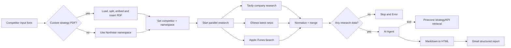

# Mobile Game Competitor Snapshot Agent

An n8n MVP for product, marketing, and product-marketing teams at a mid-sized mobile game studio. A user submits a competitor studio name and an email address; the workflow gathers company research, recent news, and iOS storefront telemetry, grounds the comparison in a studio strategy/KPI playbook, and emails a structured HTML report.

## MVP status and evidence

The primary implementation is the n8n export [Mobile Game Competitor Snapshot mk.III.json](./Mobile%20Game%20Competitor%20Snapshot%20mk.III.json). It contains 24 nodes and the implemented path is:

`Form Trigger → strategy selection → parallel research/tools → normalize and merge → availability check → AI Agent + Pinecone → Markdown-to-HTML → Gmail`

The export demonstrates the required trigger → research/tools → structured-report path. The report has four fixed sections: **Who They Are**, **How They’re Doing**, **What’s New**, and **What It Means For Our Studio**. The workflow also has retry-on-failure enabled on the three external HTTP request nodes.

## Stack decision

The primary stack is **n8n**. See [stack_decision.md](./stack_decision.md) for the decision and the secondary role reserved for LangGraph.

## Architecture and workflow overview

### Main execution path

1. **Trigger:** `Competitor Input` is an n8n Form Trigger with required `competitor` and `customerEmail` fields plus an optional PDF upload named `policyPdf`.
2. **Grounding choice:** an uploaded playbook is inserted into the `custom-strategy` Pinecone namespace; otherwise the workflow uses the default `northstar-strategy` namespace.
3. **Research/tools:** three HTTP requests run in parallel:
   - Tavily Advanced Search for company, strategy, revenue/download estimates, and source links.
   - GNews for up to five recent English-language articles.
   - Apple iTunes Search for up to five US iOS apps, ratings, rating counts, release dates, and update dates.
4. **Structured synthesis:** the normalized responses are merged. The AI Agent uses `gpt-4o-mini` and the Pinecone Vector Store tool, and is instructed to return the four-section Markdown report with cited sources and three benchmark-based actions.
5. **Delivery:** Markdown is converted to HTML and sent through Gmail to the submitted email address.
6. **Failure path:** each research HTTP node retries and can continue with an error payload. If all three sources return no data, `Check research availability` routes to `Stop and Error`.

The default grounding document is the fictional internal playbook [Northstar Nova Games Strategy & KPI Benchmarks.pdf](./Northstar%20Nova%20Games%20Strategy%20%26%20KPI%20Benchmarks.pdf), represented for reference in [northstar_nova_games_strategy_kpi_benchmarks_markdown.md](./northstar_nova_games_strategy_kpi_benchmarks_markdown.md). The optional custom upload supports the alternative [Iron Citadel Strategy & KPI Benchmarks.pdf](./Iron%20Citadel%20Strategy%20%26%20KPI%20Benchmarks.pdf) or another studio playbook.

## Setup

### Prerequisites

- An n8n instance with access to Form Trigger, HTTP Request, AI Agent, Pinecone, OpenAI, Markdown, and Gmail nodes.
- API credentials configured in n8n for Tavily, GNews, OpenAI, and Pinecone.
- A Gmail OAuth credential for the delivery node.
- A Pinecone index named `project-week6` with the default Northstar playbook ingested under the `northstar-strategy` namespace.

### Import and configure

1. Import [Mobile Game Competitor Snapshot mk.III.json](./Mobile%20Game%20Competitor%20Snapshot%20mk.III.json) from the n8n editor.
2. Rebind imported credential references to credentials in your n8n project. The export contains credential IDs/names, not secret values.
3. Confirm that the Pinecone index and namespaces match the workflow: `project-week6`, `northstar-strategy`, and `custom-strategy`.
4. Confirm the three HTTP nodes have retry enabled and that Gmail can send to the submitted address.
5. Activate the workflow and open the generated Form URL.

### Run a sample

Submit:

- **Competitor studio name:** `Playrix` (or `Supercell` for a second sample)
- **Email:** an inbox you control
- **Custom strategy PDF:** leave empty to use Northstar, or upload a compatible studio playbook

The form acknowledges the request, and the workflow sends a four-section HTML report after the research and synthesis steps complete. The attached competitor-digest presentation reports an observed demo time of approximately 40 seconds; the form copy uses a 30–45 second expectation because third-party API and model latency can vary.

## Tools and APIs

| Tool/API | Workflow role | Secret or credential | Data used in report |
| --- | --- | --- | --- |
| [Tavily Search API](https://tavily.com/) | Company and strategy research | n8n HTTP Header Auth credential | Studio profile, HQ, genres, reported estimates, source URLs |
| [GNews API](https://gnews.io/) | Current news search | n8n HTTP Header Auth credential | Up to five recent headlines, summaries, and links |
| [Apple iTunes Search API](https://developer.apple.com/library/archive/documentation/AudioVideo/Conceptual/iTuneSearchAPI/) | Live iOS storefront telemetry | No API key in this workflow | App names, genres, ratings, rating counts, release/update dates |
| [OpenAI](https://platform.openai.com/) | Chat synthesis and document embeddings | n8n OpenAI credential | Four-section report and playbook embeddings |
| [Pinecone](https://www.pinecone.io/) | Strategy/KPI retrieval (RAG) | n8n Pinecone credential | Northstar or uploaded custom playbook context |
| Gmail | Report delivery | n8n Gmail OAuth credential | Final HTML email |

## Credentials and environment variables

| Variable | Use | Required |
| --- | --- | --- |
| `N8N_ENCRYPTION_KEY` | Encrypts stored n8n credentials on a self-hosted instance | Yes for self-hosted n8n; not needed in this repo |
| `TAVILY_API_KEY` | Value for the Tavily n8n credential | Yes |
| `GNEWS_API_KEY` | Value for the GNews n8n credential | Yes |
| `OPENAI_API_KEY` | Value for the OpenAI n8n credential | Yes |
| `PINECONE_API_KEY` | Value for the Pinecone n8n credential | Yes |
| `PINECONE_INDEX` | Expected index, currently `project-week6` | Yes |
| `GMAIL_OAUTH_CLIENT_ID` / `GMAIL_OAUTH_CLIENT_SECRET` | Optional external provisioning inputs for Gmail OAuth | Only if provisioning Gmail outside n8n |

See [.env.example](./.env.example) for names only. The real `.env` file remains ignored and must never be committed.

## Repository map

| File | Purpose |
| --- | --- |
| `Mobile Game Competitor Snapshot mk.III.json` | Importable n8n workflow export; primary MVP artifact |
| `stack_decision.md` | Primary/secondary stack decision and rationale |
| `gtm_future_sprints.md` | Three future GTM sprints from the competitor-digest presentation |
| `docs/mvp_evidence.md` | Acceptance mapping and live-screenshot checklist |
| `northstar_nova_games_strategy_kpi_benchmarks_markdown.md` | Default fictional Northstar grounding/playbook text |
| `Northstar Nova Games Strategy & KPI Benchmarks.pdf` | Default playbook source document |
| `iron_citadel_strategy_kpi_benchmarks_markdown.md` | Optional fictional Iron Citadel grounding/playbook text |
| `Iron Citadel Strategy & KPI Benchmarks.pdf` | Optional custom playbook source document |
| `project3_examples_board(1).md` | Course examples and GTM terminology reference |
| `.env.example` | Non-secret environment variable names |

## Related planning

See [gtm_future_sprints.md](./gtm_future_sprints.md) for the post-MVP commercial validation plan.
